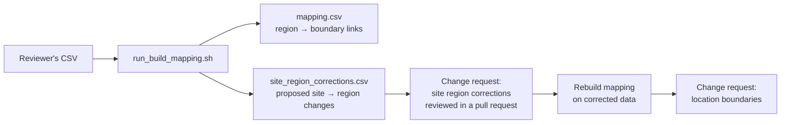

# 8. Correcting sites' regions in SEAD (plan)

Status: **plan only, 2026-11-25.** Nothing described here has been run, and no SEAD data has been changed.
Decided by Johan: corrections from the review should lead to database updates ([D-21](05-decision-log.md#d-21-review-corrections-lead-to-sead-data-updates-planned-not-yet-done)).
The details below were proposed by Claude Code; Johan has decided Q1–Q5 ([D-22](05-decision-log.md#d-22-how-sead-data-corrections-are-made)).

## Why

The review page lets the reviewer say, for a site outside its region's boundary, that the site **belongs in another unit**, for example
"this site belongs in Eksjö stad, not Eksjö socken". That is a statement about SEAD's own data: the site is attached to the wrong
region row. The mapping can't fix that; only a change to `tbl_site_locations` can.

Eksjö is only an example. The same can apply to any reviewed site.

## What the review produces

`supporting/site_region_corrections.csv`, written by `run_build_mapping.sh` from step 1 of the review page ([D-24](05-decision-log.md#d-24-the-review-is-site-based-in-two-steps-sites-then-regions)).
Step 1 asks only about a site's regions whose boundary does not contain the site's coordinates (✗):

| Choice in step 1 (`decision`) | 📍 The site's region in SEAD | In step 2 (the boundary link) | In the corrections file |
|---|---|---|---|
| Keep (`keep`) | unchanged | counts for the link if within 2 km, otherwise against | no |
| **Replace with X** (`replace`, X of the same level) | the link to the region is **replaced** by a region for X (Q1) | no longer counted | yes, with X's source and key |
| **Wrong, none of these** (`other`) | flagged; the comment says more | no longer counted | yes, handled by hand |
| **Coordinates look wrong** (`coords`) | unchanged; coordinates flagged | no longer counted | yes, as a coordinate check, not a region change |
| **Suggest adding X** (`add`, optional) | a region for X **added** beside the others | — | yes; never added without this answer |

Answers from the first, region-based versions of the page are converted: `yes` → keep, `move` → replace; a plain `no` (keep, but doesn't support the link) stays as it is.

Step 2's link decisions (`link`, `nolink`) only affect the mapping, not SEAD's site–region links.

Coordinate checks (`coords`) are out of this plan's scope: they need someone to look up the site's real position. The list goes into the corrections file so that it is not lost.

## Steps once the CSV arrives

1. **Load and rebuild.** Save the CSV as `supporting/near_boundary_review.csv` and run `supporting/run_build_mapping.sh`.
   This writes `mapping.csv` and `site_region_corrections.csv`. No database is touched except the throwaway matching workbench.
2. **Corrections are the reviewer's decisions** (Q3): `replace` and `add` rows are applied as they are. `other` rows get a target unit by hand, or are dropped.
3. **Find or create the target region row** for each correction:
   - If a SEAD location is already linked to the target boundary in `tbl_location_boundaries`, reuse it.
     (The mapping gives the reverse lookup: boundary → the locations that mean it.)
   - Otherwise a **new `tbl_locations` row** is needed, of type 2 "Sub-country administrative region",
     with a `tbl_location_boundaries` row linking it to the target boundary (`match_type = 'manual'`, a note citing the review).
     Its name follows a naming rule still to be decided (Q2).
4. **Change the site's region.** In `tbl_site_locations`, the site's link to the old region row is replaced by a link to the target row (Q1); for `add`, a link to the target row is added.
   The site's other location links (country, län, kommun, landskap) are not touched.
5. **Rebuild the mapping on the corrected data.** Corrections change which sites a region row has, so the match types of both the old and the
   new region change. The workbench already leaves replaced and flagged links out of the evidence (`region_site_eff` in `build_mapping.sql`);
   once the change request exists, the rebuilt mapping is checked against SEAD with the corrections applied, so that the two change requests agree.
6. **Write the change requests** in sead_change_control, in this order:
   1. `…_DML_SITE_REGION_CORRECTIONS` (new): generated from the corrections. Guard against re-running; check that each site is
      still linked to the expected old region; insert new region rows and their boundary links; move the site links. The verify script checks
      the counts; the revert script restores the old links and removes the new rows.
   2. `20261124_DML_LOCATION_BOUNDARIES`, regenerated from the rebuilt mapping.
7. **Test** the change requests on a scratch database first (the `lookup-test-db` container), and on `sead_staging_region_mapping` only when Johan says so.
8. **After deployment:** site reports and the Region filter read from caches (the JSON API server's MongoDB and the query API's Redis),
   which need refreshing before the change shows in the browser.

## Side effects to check

- A region row whose last site is moved away has no sites left. It then drops out of the Region filter. The row itself stays; other tables
  (`tbl_rdb`, `tbl_relative_ages`, `tbl_taxa_seasonality` and others) may reference locations, so rows are never deleted as part of this.
- A site may carry the same region row through more than one link; the change request must handle each.
- Data imported from other databases (BugsCEP, dendro lookups) may come back with the old region on a re-import, unless the source is corrected as well.

## Open questions (D-22)

Answered by Johan on 2026-11-25: Q1 replace; Q2 yes; Q3 the reviewer decides (no separate approval step); Q4 all sites outside, added as part 2 of the page; Q5 in the pull request.

| # | Question | Proposal |
|---|---|---|
| Q1 | Replace the site's link to the old region, or add the new one beside it? | **Decided: replace** |
| Q2 | How are new region rows named? | **Decided:** after the unit and its kind: "Eksjö stad", "Eksjö socken", "Laholm kommun" |
| Q3 | Is the reviewer's "belongs in X" enough, or does Johan approve each correction? | ~~Johan approves~~ **Decided: the reviewer decides** |
| Q4 | Only the 35 regions on the review page, or all sites outside their region's boundary (the `majority` and `sites_disagree` links)? | **Decided: all.** Added as part 2 of the page (45 sites, 36 regions) |
| Q5 | Who else needs to agree before SEAD data is changed (data owners, the person responsible for imports)? | **Decided:** they do so in the pull request |
