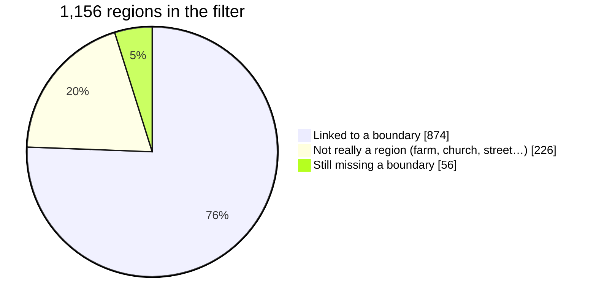
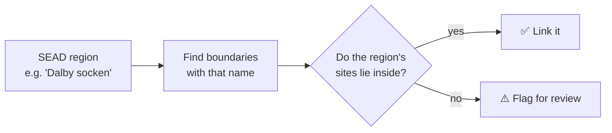

# Region → map boundaries: the short version

**Goal:** every region in SEAD's *Region* filter gets a boundary polygon, so it can be drawn on the map.

## Where we are

## How it works

Name alone isn't enough: Sweden has several parishes called *Dalby*. The sites decide which one is meant.

## Where the boundaries come from

| What | Source | Count |
|---|---|---|
| Swedish parishes (socknar) | Lantmäteriet | 613 regions |
| Swedish provinces (landskap) | built from Lantmäteriet's parishes | 24 |
| Kommuner, län, foreign regions | GADM | 237 |

Polygons live in a new database schema, **`lookup`**. The links live in a new table, **`tbl_location_boundaries`**.

## How sure are we?

| Match | Meaning | Regions |
|---|---|---|
| ✅ confirmed | name matches, all sites inside | 784 |
| 🔀 shared name | one SEAD region covers several same-named places | 23 |
| 🟡 majority | most sites inside | 34 |
| ✍️ manual | picked by hand, with a note | 15 |
| 🔤 name variant | spelling differs, sites confirm it | 13 |
| ⚠️ sites disagree | name matches, sites are elsewhere | 5 |

## Needs a decision

| # | Question | Who |
|---|---|---|
| 1 | Does "Norrbotten" mean the **landskap** or the **län**? The sites suggest the län for Norrbotten, Västerbotten and Östergötland. | Johan |
| 2 | How to get **Danish parish** boundaries (20 regions)? They now require a Datafordeler login. | Johan |
| 3 | Create the GitHub issues and **commit** the work? | Johan |

## Still to do

- 🌍 22 foreign regions: get boundaries from OpenStreetMap
- 🏙️ 13 Swedish parishes swallowed by towns before 1976 (e.g. Fosie, Badelunda): no boundary source yet
- 🏠 226 non-regions: decide case by case what they should be in SEAD
- 🗺️ Show the boundaries on the map (API and client)

**Status:** nothing committed or deployed yet. Everything is set up in a local test copy, `sead_staging_region_mapping`.

*Details: [README](README.md) · [Decision log](05-decision-log.md)*
